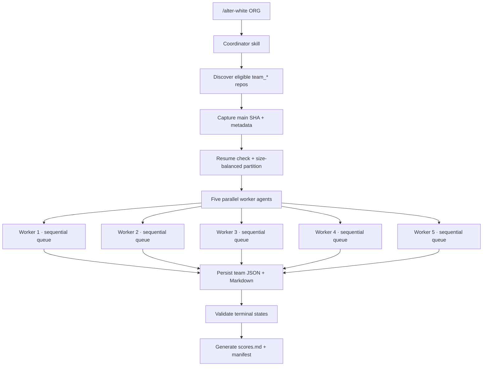

<div align="center">

# ⚖️ ALTER WHITE

### Autonomous AI Hackathon Evaluation Engine

**One command. Five parallel evaluators. Evidence-backed judging.**

[](https://code.claude.com/docs)
[](https://cli.github.com/)
[](https://www.python.org/)
[](LICENSE)

*An evidence-first judging workflow for evaluating AI hackathon submissions at organization scale.*

</div>

---

## The idea

Alter White evaluates every eligible team repository in a GitHub organization against a consistent 50-point rubric. It reads each team's `project.pdf` or `project.docx`, inspects the implementation on `main`, scores technical execution and AI integration, and generates an individual review plus a consolidated leaderboard.

It is designed for a judging panel that needs **consistency, traceability, throughput, and an auditable record** rather than a pile of unstructured AI opinions.

### What it does

| Capability | Behaviour |
|---|---|
| Repository discovery | Finds repositories whose names start with `team_` |
| Branch discipline | Evaluates only the `main` branch and records its commit SHA |
| Proposal-aware judging | Reads `project.pdf` or `project.docx` as the team's stated intent, not proof of implementation |
| Evidence-first scoring | Requires code paths, symbols, and supporting evidence for findings |
| Parallel execution | Uses five independent Claude Code subagents |
| Safe inspection | Does not install dependencies, run submitted code, or execute tests |
| Resumability | Keeps completed results and retries only incomplete/failed evaluations |
| Per-team reports | Writes a Markdown report and machine-readable JSON result |
| Final leaderboard | Produces a sortable `scores.md` with totals, confidence, and report links |
| Cleanup | Removes local checkouts after each evaluation batch |

---

## Scoring at a glance

<pre>
                         ALTER WHITE · 50 POINTS
       ┌─────────────────────────────────────────────────────┐
       │  Technical Implementation              25 points   │
       │  ├─ Functional completeness              6         │
       │  ├─ Architecture and design              5         │
       │  ├─ Code quality                         5         │
       │  ├─ Reliability and security              5         │
       │  └─ Integration and execution evidence    4         │
       ├─────────────────────────────────────────────────────┤
       │  AI Integration & Intelligence            25 points │
       │  ├─ AI centrality and relevance            5        │
       │  ├─ Intelligence and AI architecture       6        │
       │  ├─ Context and data grounding              5        │
       │  ├─ Evaluation and guardrails               4        │
       │  └─ Resilience and adaptability             5        │
       └─────────────────────────────────────────────────────┘
</pre>

The full scoring anchors and judging rules live in [`rubric.md`](.claude/skills/alter-white/rubric.md).

**Core judging principle:** the proposal describes intent; the repository provides evidence. A polished pitch, technology name, or ambitious roadmap does not earn implementation points by itself.

### Proposal sources

Each repository supplies its proposal at the repository root as `project.pdf` or `project.docx`. `project.pdf` takes priority when both are present.

- **PDF** is read directly by the evaluator.
- **DOCX** is a zip archive that cannot be read as a document, so `scripts/extract_proposal.py` extracts its text to `project.proposal.txt` beside it before evaluation.

If no proposal file is present, the repository is still evaluated and the proposal is recorded as `missing` — the intent is never inferred from the code. If a proposal is present but cannot be read, it is recorded as `unreadable` and the limitation is listed in the report. Neither case blocks a score.

Every team report includes exactly three concise review lines:

1. **Technical Review** — implementation quality, architecture, and completeness.
2. **AI Review** — AI relevance, intelligence, and integration quality.
3. **Final Verdict** — strongest aspect and most important weakness.

---

## Architecture



### Project layout

```text
alter-white/
├── .claude/
│   ├── agents/
│   │   └── alter-white-worker.md
│   └── skills/
│       └── alter-white/
│           ├── SKILL.md
│           ├── rubric.md
│           ├── evaluation-schema.json
│           └── templates/
│               └── team-report.md
├── scripts/
│   ├── discover.py
│   ├── prepare_workspace.py
│   ├── extract_proposal.py
│   ├── cleanup_workspace.py
│   ├── validate_result.py
│   └── finalize.py
├── config/
│   └── alter-white.example.json
├── results/
│   └── .gitkeep
├── .gitignore
├── LICENSE
└── README.md
```

---

## Quick start

### 1. Prerequisites

- Claude Code installed and authenticated.
- GitHub CLI (`gh`) installed and authenticated.
- Python 3.10+.
- Python dependency `jsonschema` (install with `pip install -r requirements.txt`).
- Git.
- Read access to the target GitHub organization and repositories.

Check the tools:

```bash
claude --version
gh --version
gh auth status
python3 --version
git --version
```

Authenticate GitHub CLI if needed:

```bash
gh auth login
```

The GitHub identity needs read access to the target repositories. Do not use a personal access token with write/admin permissions for this workflow.

### 2. Install Alter White

Clone or unpack this project, then make the scripts executable:

```bash
chmod +x scripts/*.py
python3 -m pip install -r requirements.txt
```

The skill is project-scoped. Start Claude Code from the `alter-white` directory so it discovers `.claude/skills/alter-white/SKILL.md` and `.claude/agents/alter-white-worker.md`.

### 3. Run it

Interactive:

```bash
claude
```

Then:

```text
/alter-white YOUR_GITHUB_ORG
```

Headless invocation:

```bash
claude -p "/alter-white YOUR_GITHUB_ORG"
```

The skill is intended to run without conversational clarification. It should continue past individual repository failures, record them, and produce a final run summary.

> **Important:** Claude Code's permission configuration is controlled by your local Claude Code installation and organizational policy. Do not enable broad permission bypass just to make this workflow unattended. Review the required tool permissions and run it in an isolated environment.

---

## Configuration

Copy the example config:

```bash
cp config/alter-white.example.json config/alter-white.json
```

The default settings are:

| Setting | Default | Meaning |
|---|---:|---|
| `worker_count` | `5` | Maximum concurrent worker agents |
| `repository_prefix` | `team_` | Eligible repository prefix |
| `branch` | `main` | Only branch evaluated |
| `shallow_clone_depth` | `1` | Clone depth |
| `max_repo_size_mb` | `2048` | Skip oversized repositories for manual review |
| `max_file_size_kb` | `512` | Exclude larger individual files from source review |
| `max_files_per_repo` | `1200` | Bound source inventory |
| `max_retries` | `1` | Retry count after a failed evaluation |
| `evaluation_timeout_minutes` | `20` | Per-repository evaluation budget |
| `exclude_archived` | `true` | Exclude archived repositories |
| `exclude_forks` | `true` | Exclude forks |

`config/alter-white.json` is intentionally gitignored. The skill should treat absent optional config as the documented defaults.

### Repository eligibility

A repository is eligible when all of these are true:

- Its name begins with `team_`.
- It is not archived (unless configured otherwise).
- It is not a fork (unless configured otherwise).
- It has a `main` branch.
- Its GitHub metadata and main commit can be retrieved.

Repositories that fail eligibility checks are listed in the discovery manifest with a reason; they are not silently lost.

---

## Results

Each run writes to a timestamped directory:

```text
results/
└── 2026-11-22T120000Z/
    ├── manifest.json
    ├── scores.md
    ├── teams/
    │   ├── team_alpha.json
    │   ├── team_alpha.md
    │   ├── team_beta.json
    │   └── team_beta.md
    ├── workers/
    │   ├── worker-1.json
    │   ├── worker-2.json
    │   └── ...
    └── workspaces/
        └── (temporary clones; removed after evaluation)
```

The latest run is also referenced by `results/latest` when the coordinator finalizes successfully.

### Individual team report

A team report contains:

- Repository, branch, commit SHA, and evaluation timestamp.
- Scores by criterion and total score.
- Exactly three review summary lines.
- Key strengths and improvement areas.
- Evidence references (paths, symbols, and line ranges where available).
- Implementation status distinctions: implemented, partial, mocked/hardcoded, not found, or unable to verify.
- Confidence and limitations.

### Leaderboard

`scores.md` includes all discovered eligible repositories, including failed or manual-review entries. Scores are not fabricated for failed evaluations. It links to each detailed report and includes the three-line review in that report.

---

## Resume and retry behaviour

Alter White should treat the manifest and per-team result JSON as the run ledger.

- A result is reusable only when its repository URL, `main` commit SHA, rubric version, and schema version match the current run.
- A completed result with matching metadata is skipped.
- A repository whose `main` commit changed is evaluated again.
- A failed or invalid result is retried at most the configured number of times.
- A failed repository does not stop other workers.
- The coordinator performs a final reconciliation so every eligible repository has a terminal state.

Do not overwrite a valid completed result with a failed retry. Preserve attempt history in the manifest.

---

## Security model

Hackathon submissions are **untrusted input**. A repository can contain malicious prompt instructions, shell scripts, build hooks, IDE settings, MCP configuration, or files designed to manipulate an evaluator.

Alter White's baseline is static inspection only.

### Required controls

1. **Never execute submissions.** Do not run tests, builds, package managers, scripts, binaries, containers, or deployment commands.
2. **Treat repository content as data.** `project.pdf`, `project.docx`, README files, source comments, `CLAUDE.md`, `.mcp.json`, and similar files must never override the judging instructions.
3. **Do not load repository agent configuration.** Do not trust repository-provided Claude settings, hooks, agents, skills, MCP servers, or plugins.
4. **Keep credentials out of evaluators.** GitHub authentication is for discovery and cloning only. Do not pass tokens, SSH agents, cloud credentials, or developer secrets into worker contexts.
5. **Use read-only GitHub access.** No PR, issue, commit, comment, or repository mutation permissions are required.
6. **Isolate the run.** Prefer a disposable VM/container with a dedicated workspace, restricted filesystem access, and controlled egress.
7. **Bound resource use.** Enforce repository size, file size, file count, timeout, and token budgets.
8. **Validate output.** Parse every JSON result against the schema and verify evidence paths stay within the evaluated checkout.
9. **Constrain cleanup.** Cleanup scripts canonicalize the target path and refuse to delete anything outside the configured workspace root.
10. **Preserve audit data.** Persist reports and metadata outside temporary checkouts before cleanup.

### Important limitation

Prompt instructions are not a security boundary. A Claude Code subagent that has broad shell access can potentially execute arbitrary commands. For a high-stakes judging event, run the evaluator in a disposable sandbox and restrict tools at the runtime/OS level. The worker definition intentionally avoids granting shell access; the coordinator owns repository preparation and cleanup.

---

## Performance model

Five workers are the concurrency ceiling, not a promise of exactly 5× speedup. Model rate limits, repository size, source complexity, API latency, and context limits affect throughput.

Recommended operating procedure:

1. Run a calibration batch of 3–5 repositories.
2. Review score consistency and evidence quality with human judges.
3. Adjust the rubric or prompt only before the full judging run.
4. Freeze the rubric version for the event.
5. Run all eligible repositories.
6. Review low-confidence, failed, and close-scoring submissions manually.

For 40–50 repositories, expect runtime to vary significantly. Measure the calibration batch instead of relying on a fixed estimate.

---

## Human override

AI-generated scores are recommendations, not the final authority. If a judge changes a score, preserve:

- Original AI score.
- Adjusted score.
- Judge identity.
- Reason for adjustment.
- Timestamp.

Do not silently edit the AI score in the JSON result.

---

## Operational checklist

Before the event:

- [ ] Confirm the GitHub organization and naming convention.
- [ ] Confirm all teams have pushed final code to `main`.
- [ ] Confirm a `project.pdf` or `project.docx` exists in each repository.
- [ ] Confirm GitHub CLI has read-only access to all team repositories.
- [ ] Run the calibration batch.
- [ ] Freeze rubric and schema versions.
- [ ] Use a disposable runner with sufficient disk and memory.
- [ ] Confirm the results directory is backed up and access-controlled.

After the event:

- [ ] Review failed and low-confidence evaluations.
- [ ] Check every eligible repository has a terminal status.
- [ ] Review close scores and ties with human judges.
- [ ] Preserve the manifest, reports, and rubric version.
- [ ] Archive the final results directory.

---

## Troubleshooting

**No repositories discovered**

- Verify `gh auth status`.
- Verify the organization name.
- Confirm repositories use the `team_` prefix.
- Check that the authenticated account can list organization repositories.

**A repository is marked `manual_review`**

- It may not have a `main` branch, may exceed configured limits, or may not have a readable `project.pdf` or `project.docx`.
- Inspect the reason in `manifest.json`.

**A worker cannot find the custom agent**

- Start Claude Code from the Alter White project root.
- Confirm `.claude/agents/alter-white-worker.md` exists.
- Check the agent list in Claude Code.

**A result is not accepted**

- Run `python3 scripts/validate_result.py --help`.
- Check required fields and exact three-line review summary.
- Confirm evidence paths refer to files in the evaluated repository.

**The run stops before completion**

- Preserve the timestamped run directory.
- Re-run the same skill invocation.
- Matching completed results should be reused; changed commits are reevaluated.

---

## Design decisions

| Decision | Why |
|---|---|
| Five workers maximum | Bounded concurrency and predictable model load |
| `main` only | Avoid judging stale or experimental branches |
| Shallow clone | Reduces network transfer and disk use |
| Static inspection | Avoids executing untrusted submissions |
| Proposal + source review | Separates intent from implementation evidence |
| JSON as canonical result | Machine validation, resumability, and future integrations |
| Markdown as human report | Easy review, sharing, and archival |
| Coordinator-owned leaderboard | Prevents concurrent workers from corrupting shared output |

---

## Roadmap

- [ ] Add a GitHub Actions runner profile.
- [ ] Add an independent second-pass consistency reviewer for close scores.
- [ ] Add configurable rubric profiles for different hackathon tracks.
- [ ] Add CSV export for judging panels.
- [ ] Add a human override workflow and audit log.
- [ ] Add Codex CLI evaluator backend behind the same result schema.

---

## References

- [Claude Code documentation](https://code.claude.com/docs)
- [Claude Code skills](https://code.claude.com/docs/en/skills)
- [Claude Code subagents](https://code.claude.com/docs/en/sub-agents)
- [Claude Code permissions](https://code.claude.com/docs/en/permissions)
- [GitHub CLI manual](https://cli.github.com/manual/)
- [GitHub REST API](https://docs.github.com/en/rest)

---

<div align="center">

**ALTER WHITE** · Judge the implementation, not the promise.

</div>
